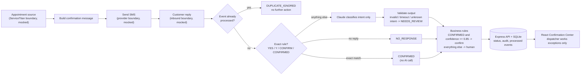

# Comfort Pro Confirmation Center

**An appointment-confirmation automation that turns a dispatcher's morning from "call every customer" into "work only the exceptions."**

Rules first, AI second. AI interprets, business rules decide. Anything uncertain goes to a person.

`Node 20+` · `Express + SQLite` · `React` · `n8n` · `Anthropic Claude (classification only)`

---

## Outcome

Ten appointments go in. The system texts each customer, reads the replies, and resolves the routine ones. The dispatcher opens one screen and sees only what needs her.

| | Count | What Happened |
|---|---|---|
| Appointments processed | 10 | Confirmation text built for each one |
| Confirmed automatically | 6 | 1 by an exact rule (no AI), 5 by AI interpretation above the confidence gate |
| Sent to the dispatcher | 4 | 1 schedule change, 1 question, 2 no response |

The system never reschedules, cancels, prices or dispatches anything on its own. The customer who asks to move her appointment gets routed to a person; the schedule is untouched.

---

## The Client Problem

A residential HVAC and plumbing company (about $12M revenue, 14 technicians, one dispatcher) spends roughly 1.5 to 2 hours every morning phoning customers to confirm they will be home. About half do not answer. No-shows waste technician time and truck rolls.

The owner raised three ideas: a website chatbot, appointment confirmations, and after-hours call intake. I treated that as a prioritization problem, not a build list:

| Opportunity | Evidence Today | Decision |
|---|---|---|
| Appointment confirmations | Measured daily workload and observed no-shows | **Build first** |
| After-hours intake | Possible lost revenue, but call volume and conversion are unknown | Measure during the pilot, then decide |
| Website chatbot | No defined problem or success metric | Hold |

---

## How It Works



### Three Replies, Three Paths

| Customer Reply | Path | Result |
|---|---|---|
| `YES` | Exact-match rule. No model call, so no cost, no latency, fully deterministic. | Confirmed |
| `My wife will be there` | The model reads the sentence and returns an intent and a confidence. Business rules gate it. | Confirmed (95%) |
| `Can we move this to tomorrow afternoon?` | The model detects a schedule change. Policy says a person decides, regardless of confidence. | Dispatcher review. **No schedule change is made.** |

### Failure Modes Are Designed, Not Discovered

| What Goes Wrong | What the System Does |
|---|---|
| Model returns invalid JSON, times out, or returns an unknown intent | `NEEDS_REVIEW`, routed to a person |
| Model is unsure (confidence below 0.85) | `NEEDS_REVIEW`, never an automatic confirmation |
| Customer reply is ambiguous ("probably", "call me") | Dispatcher review |
| Customer says `WHY` | Does not match the rule for `Y`; the anchored pattern is `^(YES\|Y\|CONFIRM\|CONFIRMED)$` |
| Same inbound message arrives twice | Blocked before classification, acknowledgement or any write |
| Customer confirms, then asks to change | Current status updates; earlier events stay in history |
| Customer replies after the 5:30 PM checkpoint | Processed normally. The checkpoint means "stop waiting and escalate," not "stop accepting replies." |
| Customer text tries to instruct the model | The prompt tells the model to ignore embedded instructions and classify the text as ordinary customer speech; the model's output is still validated and gated by business rules, so it cannot take an action even if manipulated |

---

## Built Like a Pilot, Not a Demo

Every external system sits behind a clearly marked boundary, so moving from prototype to pilot means replacing one boundary at a time.

| Boundary | In This Repository | Pilot Replacement |
|---|---|---|
| Appointment source | `automation/data/appointments.json` | Supported ServiceTitan export, API or webhook |
| Outbound SMS | Message built and recorded as `SIMULATED_SENT` | Approved SMS provider or existing messaging infrastructure |
| Inbound SMS | `automation/data/responses.json` | Inbound messaging webhook |
| Status write-back | Local SQLite database | Supported ServiceTitan status update, or surface exceptions in the dispatcher's existing workflow |
| Sign-in | Local demo sign-in | Real identity provider |

Pilot replacements are subject to available ServiceTitan API and integration capabilities, which the first rollout step confirms before anything is built.

What is real and runs end to end: the rules, the classifier prompt and call path, the confidence gate and routing, idempotency claims in a database, state history, the API, and the dispatcher UI reading from that API.

Design write-ups:

- [`docs/DESIGN_DECISIONS.md`](docs/DESIGN_DECISIONS.md): the key decisions, the alternatives considered, and the trade-offs.
- [`docs/PRODUCTION_READINESS.md`](docs/PRODUCTION_READINESS.md): risk register, production requirements, rollout plan and pilot success metrics.
- [`docs/DEMO_SCRIPT.md`](docs/DEMO_SCRIPT.md): a three-minute walkthrough.

---

## Quality Evidence

| Evidence | Result |
|---|---|
| Primary scenario | 10 total, 6 confirmed, 4 exceptions (4473, 4477, 4478, 4480) |
| Edge-case suite | 23/23: every reply category, failure paths, state override, duplicate short-circuit, exact-match safety, late reply after no-response |
| Engine to database | Sync writes 10 / 6 / 4; a second run ignores all ten events as duplicates; claims and state survive a backend restart |
| Browser checks against the live backend | 37/37: KPIs, filters, search, KPI-card navigation, detail drawers, mark reviewed, date navigation, Activity, Calendar, mobile width |
| n8n workflow, structural validation | Connections resolve, node types match their contents, no orphaned nodes, embedded prompt identical to the canonical prompt, threshold equal to the engine's, duplicate branch cannot reach the model |
| Clean-install check | Fresh extract, `npm run setup`, tests, demo, build and browser checks all pass |

Recorded output: [`docs/TEST_RESULTS.md`](docs/TEST_RESULTS.md).

**Verification Levels, Kept Separate on Purpose**

| Level | Status |
|---|---|
| Automation logic executed locally | Verified |
| Edge cases executed locally | Verified |
| Engine, API, database and UI executed together | Verified |
| n8n workflow structure | Validated by script (does not run n8n) |
| n8n workflow executed in a local n8n instance with a live Claude call | Run by the author; execution evidence to be added under `docs/` |
| Node engine making a live Anthropic call | Supported by the code path; automated runs use the fixture so tests need no API key |

---

## Run It Locally

Requirements: Node 20+ and npm. Python 3 with Playwright is needed only for the optional browser check.

```bash
git clone https://github.com/aswathy-chandrasekar/comfort-pro-confirmation-center.git
cd comfort-pro-confirmation-center
npm run setup
```

**1. Automation Tests** (No Servers, No API Key)

```bash
npm run test-all
```

**2. Full Demo** (Three Terminals)

```bash
npm run backend:start     # terminal 1: API on :4000
npm run demo              # terminal 2: seed, reset, run the engine into the backend
npm run frontend:start    # terminal 3: dispatcher UI on :3000
```

Sign in with the pre-filled credentials. Expected: 10 appointments, 6 confirmed, 4 needing review (Angela Brooks, Patricia Lyons, Kevin Marsh, Bill Sanders). `npm run demo` resets first, so it is safe to repeat. Running only the sync step again shows idempotency: all ten events report `DUPLICATE_IGNORED`.

**3. Browser Check** (Optional)

```bash
pip install playwright && playwright install chromium
python frontend/e2e/check_ui.py
```

**Live Classification** (Optional): copy `.env.example`, set `ANTHROPIC_API_KEY`, and run the engine or sync script. Without a key the classifier uses `automation/data/llm_fixture.json`. The model name is set in `automation/src/engine.js` and in the n8n HTTP node; change both together.

**n8n**: import `automation/workflow/Comfort_Pro_Confirmations.json` and create the header credential the "Classify Intent" node expects. Run `npm run automation:workflow:validate` after any edit.

---

## Scope and Roadmap

This is the smallest system that proves the business case end to end. What it deliberately leaves for the pilot phase:

| Next Step | Why It Is a Pilot Step, Not a Prototype Step |
|---|---|
| Connect n8n to the backend API | The UI is currently fed by the sync script that runs the same engine. Wiring n8n's HTTP nodes to the same endpoints is a contained change. |
| Real timestamps and an audit-driven Activity page | The Activity page already uses recorded send, reply and checkpoint times; moving it to read the audit table directly is a next iteration. |
| Consent and opt-out handling, retries, delivery receipts | Depend on the chosen SMS provider and counsel's guidance; specified in the readiness document. |
| Tune the 0.85 confidence gate | It is a conservative starting assumption; calibrate it against dispatcher-reviewed historical replies. |
| API authentication and monitoring | Required before any real customer data; specified in the readiness document. |

Known behaviors worth knowing: the UI polls the API every 3 seconds; only "tomorrow" has a live batch; "Mark reviewed" is local UI state and does not write to ServiceTitan; the frontend build uses `DISABLE_ESLINT_PLUGIN=true` (set in `frontend/.env`) because of a toolchain version clash, and a `patch-package` patch for `ajv-keywords` applies automatically on install.

---

## Repository Layout

```
automation/
  src/        engine.js, classifier_prompt.js, state_store.js
  data/       appointments.json, responses.json, edge_cases.json, llm_fixture.json
  tests/      run_primary.js, run_edge_cases.js
  scripts/    sync_to_backend.js
  workflow/   Comfort_Pro_Confirmations.json, validate_workflow.js
  output/     audit.json, dashboard_data.json, linda_email.html (regenerated by tests)
backend/      server.js, db.js, seed.js, reset-demo.js
frontend/     React app, patches/, e2e/check_ui.py
docs/         DESIGN_DECISIONS.md, PRODUCTION_READINESS.md, DEMO_SCRIPT.md, TEST_RESULTS.md
```

Licensed under the MIT License. See [`LICENSE`](LICENSE).
