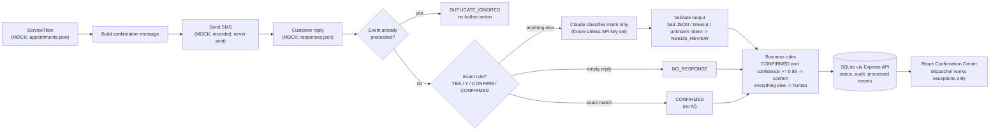

# Comfort Pro Confirmation Center

An appointment-confirmation automation for a fictional HVAC/plumbing company, built as an AI & Automation Engineering case study.

**The idea:** instead of a dispatcher phoning every customer each morning, the system texts them, understands the replies, confirms the routine ones automatically, and hands the dispatcher a short list of exceptions.

```
10 appointments  ->  6 confirmed automatically  ->  4 need a human
```

> **Principles:** rules first, AI second. AI interprets, business rules decide. Automate certainty, escalate ambiguity.

ServiceTitan, SMS sending and inbound SMS are **mocked**. Everything else described below runs. See [Verification status](#verification-status) for exactly what was and was not executed.

---

## The business problem

The owner (Gary) says his dispatcher (Linda) spends roughly 1.5 to 2 hours every morning calling customers to confirm they will be home. About half do not answer. No-shows waste technician time and cause unnecessary truck rolls. This was chosen as the first pilot over a website chatbot (no defined problem) and after-hours intake (potentially bigger, but the baseline is unknown and should be measured first). The one-page business case is in [`Comfort_Pro_Scoping_One_Pager.pdf`](Comfort_Pro_Scoping_One_Pager.pdf). Its dollar figures are illustrative planning assumptions, not measured savings.

---

## Architecture



| Part | Folder | Role |
|---|---|---|
| Automation engine | `automation/src` | Deterministic rules, classifier prompt, confidence gate, routing, state/idempotency. Plain Node, no dependencies. |
| n8n workflow | `automation/workflow` | Importable n8n export of the same pipeline, plus a structural validator. |
| Backend | `backend` | Small Express + SQLite API: durable idempotency claims, appointment state, audit rows. |
| Sync script | `automation/scripts/sync_to_backend.js` | Runs the engine and writes results to the backend over HTTP. This is what connects automation to the UI. |
| Frontend | `frontend` | React dispatcher console. Renders what the backend holds; it contains no classification logic. |

### Rules first, AI second (three example customers)

| Customer | Reply | Path | Result |
|---|---|---|---|
| Denise Harper | `YES` | Exact-match rule, **no AI call** | Confirmed |
| Robert Chen | `My wife will be there` | Claude interprets (CONFIRMED, 0.95) | Confirmed |
| Angela Brooks | `Can we move this to tomorrow afternoon?` | Claude interprets (RESCHEDULE, 0.98) | Sent to dispatcher. **No schedule change is made automatically.** |

### Safety behaviour

- Only an AI result of `CONFIRMED` with confidence **>= 0.85** auto-confirms. The threshold is a pilot assumption, not a calibrated value. Production would tune it against dispatcher-reviewed historical replies.
- Reschedule, cancel/change, question and ambiguous replies always go to a human regardless of confidence.
- Malformed output, timeouts, unsupported intents and low confidence all become `NEEDS_REVIEW`. Failure degrades toward a human, never toward an automated action.
- The exact-match rule is anchored (`^(YES|Y|CONFIRM|CONFIRMED)$`), so `WHY` does not match `Y`.
- Duplicate events are blocked before any classification, acknowledgement or write. The backend stores claimed event ids in SQLite, so protection survives restarts.
- State and history are separate. A later message can change the current status (confirmed, then reschedule) without erasing earlier events.
- **Response checkpoint (5:30 PM):** at the checkpoint an unanswered appointment becomes `NO_RESPONSE` and goes to the dispatcher. It is a point to stop waiting, not a point to stop accepting replies. A later reply is processed normally and flips the current status while the `NO_RESPONSE` history is preserved (covered by an automated test).

---

## Quick start

Requirements: **Node 20+**, npm, and Python 3 with Playwright only if you want to run the UI check.

```bash
git clone <your-repo-url> comfort-pro && cd comfort-pro
npm run setup            # installs backend + frontend dependencies
```

### 1. Run the automation tests (no backend, no API key needed)

```bash
npm run test-all
```

Runs the primary scenario (expects 10 / 6 / 4), the 23 edge cases, and the n8n structural validator.

### 2. Run the full demo

Open three terminals in the repo root.

```bash
# terminal 1: backend API on :4000
npm run backend:start

# terminal 2: seed, reset, then run the engine into the backend
npm run demo

# terminal 3: dispatcher UI on :3000
npm run frontend:start
```

Sign in with the pre-filled demo credentials. You should see 10 appointments, 6 confirmed, 4 needing review: Angela Brooks (schedule change), Patricia Lyons (question), Kevin Marsh and Bill Sanders (no response).

`npm run demo` is safe to repeat: it resets the database first. Running just the sync step twice shows idempotency: the second run reports `DUPLICATE_IGNORED` for all ten events and changes nothing.

### 3. Run the UI check (optional)

With the backend and frontend running and `npm run demo` completed:

```bash
pip install playwright && playwright install chromium
python3 frontend/e2e/check_ui.py
```

It drives the real UI against the live backend (35 checks: KPIs, filters, search, KPI-card navigation, drawers, mark reviewed, date navigation, Activity, Calendar, mobile width).

### Live classification with Anthropic (optional)

Copy `.env.example`, set `ANTHROPIC_API_KEY`, and export it before running the engine or sync script. With a key, `automation/src/engine.js` calls the Anthropic Messages API with the canonical prompt in `automation/src/classifier_prompt.js`; without one it uses `automation/data/llm_fixture.json`. The test suite never needs a key. The model name is set in `engine.js` and in the n8n HTTP node; update both together.

### n8n

Import `automation/workflow/Comfort_Pro_Confirmations.json` into n8n and create the Anthropic HTTP header credential the "Classify Intent" node expects. The workflow is the orchestration representation of the same logic as the Node engine. It is hand-maintained (there is no generator), and `npm run automation:workflow:validate` checks it against the engine: same 0.85 threshold, embedded prompt identical to `classifier_prompt.js`, no orphaned nodes, duplicates cannot reach the AI node.

---

## Mocked boundaries

| Boundary | What the prototype does | Production replacement (subject to available ServiceTitan API/integration capabilities) |
|---|---|---|
| ServiceTitan appointment retrieval | `automation/data/appointments.json` | Supported ServiceTitan export/API/webhook |
| Outbound SMS | Message is built and stored with `delivery_status = SIMULATED_SENT`; nothing is sent | Approved SMS provider or existing messaging infrastructure |
| Inbound SMS | `automation/data/responses.json` | Inbound messaging webhook |
| ServiceTitan status write-back | Status is written to the local SQLite database only | Supported ServiceTitan status update, or surface exceptions in the dispatcher's existing workflow |
| Authentication | Local demo sign-in, no real auth. Backend has open CORS and no auth. | Real identity provider and API auth |

---

## Verification status

Levels are deliberately kept separate.

**VERIFIED (executed and observed in the latest review run)**

- Primary scenario: 10 total, 6 confirmed, 4 exceptions (4473, 4477, 4478, 4480).
- Edge cases: 23/23 pass, including state override, duplicate short-circuit, exact-match safety and late reply after no-response.
- n8n structural validation passes (see below for what that does and does not mean).
- Backend API: duplicate event claims are rejected, invalid statuses are rejected (HTTP 400), and both claims and appointment state persist across a backend restart.
- Engine to backend to database: sync produces 10 / 6 / 4; a second sync ignores all ten events as duplicates.
- Frontend production build and dev-server compile.
- React UI against the live backend: 35/35 browser checks.

**STRUCTURALLY VALIDATED (not executed)**

- The n8n workflow JSON: valid shape, connections resolve, node types match their contents, every node reachable, embedded prompt identical to the canonical prompt, threshold equals the engine's, duplicate branch cannot reach the AI node. This does not run n8n.

**AUTHOR-REPORTED, NOT REPRODUCIBLE FROM THIS REPOSITORY**

- The workflow was executed in a local n8n instance with a live Anthropic call, producing 10 / 6 / 4. No execution log or screenshot is committed, so this repository cannot prove it. Adding one under `docs/` would close the gap.

**NOT VERIFIED**

- A live Anthropic call from the Node engine or sync script (all automated runs use the fixture).
- The n8n workflow writing to the backend. The n8n export has no HTTP node pointing at the backend; the UI is fed by `sync_to_backend.js`, not by n8n.

---

## Known limitations

- The UI polls the backend every 3 seconds. There is no websocket and no real-time push.
- Only "tomorrow" has a live batch. Navigating to other dates shows no appointments by design.
- The Activity page builds its entries from appointment fields in the backend, not from the `audit_events` table. Some event times (such as the 5:00 PM batch send and the 5:30 PM checkpoint) are display conventions rather than recorded timestamps.
- "Mark reviewed" and the action buttons change local UI state only. They do not update the backend or ServiceTitan.
- Reply timestamps in the demo are generated relative to the time you run `npm run demo`.
- The frontend production build requires `DISABLE_ESLINT_PLUGIN=true` (set in `frontend/.env`, so it works on Windows, macOS and Linux) because of an ESLint version clash in the Create React App toolchain. A `patch-package` patch for `ajv-keywords` is applied automatically on install.
- At 1440 px the queue table's action column can require a small horizontal scroll inside the table; it fits at 1600 px and above.
- Customer consent, opt-out handling, retries, and production monitoring are described in the scoping document but not implemented.

---

## Production rollout (outline)

1. Audit what Comfort Pro already has in ServiceTitan first; use existing capabilities before adding software.
2. Replace the mocked boundaries one at a time (appointment source, SMS, inbound webhook, status write-back).
3. Move idempotency, state and audit to production storage (the backend already demonstrates the claim pattern).
4. Validate timing, wording, escalation and cancellation rules with the dispatcher.
5. Pilot one location for 2 to 4 weeks. Measure dispatcher minutes per day, auto-confirm rate, exception rate, no-show rate, classification errors and cost per appointment. Expand, adjust or stop on measured value, not on the demo numbers.

---

## Repository layout

```
automation/
  src/            engine.js, classifier_prompt.js, state_store.js
  data/           appointments.json, responses.json, edge_cases.json, llm_fixture.json
  tests/          run_primary.js, run_edge_cases.js
  scripts/        sync_to_backend.js
  workflow/       Comfort_Pro_Confirmations.json, validate_workflow.js
  output/         audit.json, dashboard_data.json, linda_email.html (regenerated by tests)
backend/          server.js, db.js, seed.js, reset-demo.js   (SQLite file is created at runtime)
frontend/         React app, patches/, e2e/check_ui.py
docs/             TEST_RESULTS.md (recorded run from a fresh extract)
Comfort_Pro_Scoping_One_Pager.pdf
```
